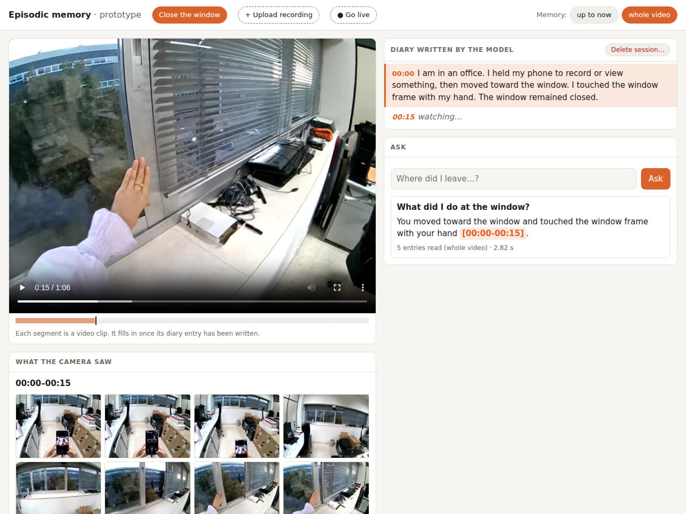

# Episodic memory assistant (prototype)

Prototype of an assistant that records what a person does with a wearable camera and answers questions about their recent past: "where did I leave my keys?", "did I turn off the stove?". It is aimed at mild cognitive impairment and early Alzheimer's disease.



*The sample recording in the demo page: the answer cites the moment it comes from, and the frames behind it show what the describer missed (the hand is pushing the window shut; the diary says it "remained closed").*

```
video ─▶ 15 s clips ─▶ [describer · VLM] ─▶ timestamped text diary
                                                     │
                  question ─▶ [reader · LLM] ◀───────┘─▶ answer + cited moment
```

1. **Describer.** A vision-language model looks at 8 frames of each clip and writes one first-person diary entry.
2. **Memory.** The diary is stored as timestamped text (`memory.jsonl`). It is all the reader needs.
3. **Reader.** A language model answers from the diary alone and cites the moment it relied on.

It works on recordings and live, from [Pupil Labs Neon](https://pupil-labs.com/products/neon) glasses: a small relay on the glasses' phone sends only the photos the diary needs, so a weak Wi-Fi delays them instead of losing them.

The reference implementations are two papers from Antonino Furnari's group at the University of Catania:

- Lando, Forte, Farinella and Furnari, [*How Far Can Off-the-Shelf Multimodal Large Language Models Go in Online Episodic Memory Question Answering?*](https://arxiv.org/abs/2506.16450), arXiv:2506.16450, 2025.
- Lando, Forte and Furnari, [*Exploring Multimodal LMMs for Online Episodic Memory Question Answering on the Edge*](https://arxiv.org/abs/2602.22455), arXiv:2602.22455, 2026. The prompts and the four-option evaluation follow this one.

## Try it with a sample recording

A 66-second recording made with the Neon glasses in our office (walking to a window, pushing it shut, going through two doors) is attached to the first release, so you can see the whole loop without any dataset.

```bash
git clone https://github.com/Enminxo/ego-memory-assistant && cd ego-memory-assistant
uv sync
ollama pull gemma4:31b      # 19 GB, describer and reader; see "Models" below
uv run egomem-app           # http://localhost:8090
curl -LO https://github.com/Enminxo/ego-memory-assistant/releases/download/v0.1.0/close-the-window.mp4
```

On the page, *+ Upload recording* takes `close-the-window.mp4`. The diary is written as the video is read, one entry per 15 s, and then you can ask it questions:

- "What did I do at the window?" and "Did I open a door?" are answered from the diary, with the moment they come from.
- "Did I close the window?" fails, and it is worth seeing why: the window is pushed shut at 0:11-0:15, but the diary only says that a hand touched the window (in one of our two runs it even added "the window remained closed"). A question can only be answered if the describer wrote it down.

## Models

Models are served by any server with an OpenAI-compatible API. On a DGX Spark we use [Ollama](https://ollama.com) with `gemma4:31b` for both roles. Server and models are set in `configs/demo.yaml`; to use llama-server or vLLM, change `base_url` and `model`.

The describer is the slow part, and its time grows with the image size, because most of it goes into reading the image. With gemma4:31b and the GPU to itself, 8 frames take about 11 s at 960×540, 18 s at 1280×960 and 26 s at 1600×1200 (the Neon scene camera's size). Smaller models are much faster (gemma4:e4b, about 5 s at full size) but in our tests they described objects that were not there. Smaller describers have not been evaluated beyond that.

## Demo scenes from Ego4D

Four 8-minute clips from [Ego4D](https://ego4d-data.org) with [QAEgo4D](https://github.com/lbaermann/qaego4d) questions, one scene per need: stove, keys, medication and wallet (`scripts/demo_scenes.yaml`). **Both datasets require signing their licenses**, so the scenes are not in the repository: the script below builds them from your own copies.

```bash
./scripts/make_demo_scenes.sh           # cuts the videos and writes scenarios/*.json
```

## Usage

```bash
uv run egomem-build gas keys meds wallet           # video -> diary (data/memories/<scene>/default/)
uv run egomem-eval gas keys meds wallet            # accuracy on four-option questions
uv run egomem-eval gas keys meds wallet --no-memory   # control: the same reader without a diary
uv run egomem-app                                  # web demo at http://localhost:8090
uv run pytest                                      # tests
```

The `--no-memory` control is essential. QAEgo4D's wrong options were generated automatically and are often absurd ("on the ceiling", "who cares"), so a model scores well above the 25% chance level without seeing anything. What shows that the memory works is the gap to that control.

In the evaluation the reader must always pick a letter (decoding constrained to A-D). Left free, with the diary in front of it, it declines to choose when the diary does not mention what is asked, and each refusal counts as a miss only for the arm that has a diary.

**Where it stands.** On the 59 questions of the four scenes, the reader with the diary got 47-54% right and without it 41-42%: 5 to 14 points better over three runs. Every 95% interval of that gap reaches zero, so with this few questions the gain is not established. The failures repeat in kind: the describer misreads gestures (the stove "switched off" when it was only touched), writes negatives nobody asked for ("no medication was taken"), and misses objects in blurred frames. The demo questions in `scripts/demo_scenes.yaml` include some that fail on purpose.

## Adding your own recording

A scene is a JSON file in `scenarios/` with the video and its questions (the format is described in `src/egomem/scenarios.py`). For your own recording, write it by hand:

```json
{
  "id": "pill", "title": "Did I take my pill?", "category": "medication",
  "video": "data/scenes/pill.mp4",
  "questions": [{"id": "p1", "question": "Did I take my pill?", "answer": "yes",
                 "wrong_answers": ["no", "I took two", "I only opened the box"],
                 "t0": 95.0, "t1": 102.0, "category": "medication"}],
  "demo_questions": [{"text": "Did I take my pill?", "expected": "yes"}]
}
```

## Using Pupil Labs Neon glasses

Neon is a sensor, not a computer: the glasses are wired to their companion phone, which records and streams over Wi-Fi. The assistant runs on another machine, and only the scene camera is used so far.

```bash
uv sync --extra neon
```

**Record, then ask.** Record with the Neon Companion app, copy the recording folder (native format) from the phone over USB, and turn it into a scene. The video is rewritten at a constant rate from Neon's own frame timestamps, so the diary's times are the real ones.

```bash
uv run egomem-neon import ~/data/neon/<recording> --id kitchen --title "My kitchen"
# add questions to scenarios/kitchen.json, ideally before reading the diary
uv run egomem-build kitchen
uv run egomem-app
```

**Or upload it from the page.** In `egomem-app`, *+ Upload recording* takes the recording folder, Pupil Cloud's "Native Recording Data" zip, or any video file. The app converts it, writes the diary right away and opens it as a new tab, whose diary fills in as it is written.

### Live through the phone (recommended)

The whole scene video is about 5 Mbit/s, and on our office Wi-Fi it did not fit: one afternoon 13 of 22 live clips were lost. Inside the phone nothing is in the way, so a relay runs there, next to the Companion app. It reads the video at 127.0.0.1, picks the 8 photos of each clip and sends only those, about 0.7 Mbit/s. If the network drops, the photos wait on the phone and catch up later; each one keeps the time it was taken.

```
glasses ─USB─▶ Companion app ─RTSP 127.0.0.1─▶ phone_relay.py ─photos─▶ egomem-app
               (on the phone)                  (Termux, same phone)     (your computer)
```

1. Install [Termux](https://f-droid.org/packages/com.termux/) (we used the F-Droid build), and [Tailscale](https://tailscale.com) on the phone and on the computer, so they reach each other on any network.
2. In Termux: `pkg install python ffmpeg`, then fetch the relay, a single file with no dependencies beyond the standard library:
   ```bash
   curl -LO https://raw.githubusercontent.com/Enminxo/ego-memory-assistant/master/src/egomem/phone_relay.py
   python phone_relay.py --bind <phone-tailscale-ip>
   ```
3. With the glasses plugged in and the Companion app open, go to `egomem-app`, press *● Go live*, type the phone's Tailscale address and choose *the phone relay*.

The page shows the photos arriving, how late they are and how many wait on the phone. In a 10-minute test on 27 October 2026, all 403 photos arrived, none lost, about half a second late. The diary did not keep up, though: at full size the describer needs about 26 s per 15 s clip, so about 4 clips in 10 were dropped. A clip the describer cannot reach in time is dropped and counted, never described late as if it were the present.

The relay also serves the newest photo at `GET /latest.jpg` (3 per second) and speaks text through the phone with `POST /say` (needs `pkg install termux-api` and the Termux:API app). We use both for a separate experiment that greets people by name; it is not part of this repository.

### Live, the whole video

*● Go live* can also read the whole video straight from the Companion app, which needs a good network. The same session runs from the terminal:

```bash
uv run egomem-live --neon <phone-ip> --probe   # phone, frames per second and lag; saves logs/neon_probe.jpg
uv run egomem-live --neon <phone-ip>           # a diary entry every 15 s, until Ctrl+C
uv run egomem-app                              # another terminal: the session is the tab marked ●
```

The phone and the computer must reach each other: on the same local network (the phone's IP is shown in the Companion app's streaming screen; eduroam usually does not work), or with Tailscale on both, passing the phone's Tailscale IP. Searching the network (no `--neon`) does not work through Tailscale.

The video is read over the Companion app's WebSocket (port 8686), the path its Monitor web page uses. The app's plain RTSP stream (port 8086) sends UDP, and on our office Wi-Fi no keyframe ever arrived whole. Over the WebSocket nothing is lost, but when the Wi-Fi carries less than the video's bitrate the phone sends fewer frames and the rest queue up and arrive late: 0.07 to 0.4 s and 25-30 frames per second on a good network, 15 to 30 s and 5-10 frames per second on a congested one (office Wi-Fi, 26 October 2026). Past about 20 s the connection's keepalive times out and it reconnects.

`--record` also records on the phone, which keeps gaze and audio for later. It is off by default because a recording may upload to the phone's Pupil Cloud workspace.

## Pieces you can reuse on their own

- **`src/egomem/neon_stream.py`**: Neon's scene camera, live, over the Companion app's WebSocket instead of UDP RTSP, with only `websockets` and PyAV. Useful whenever the plain RTSP stream loses keyframes on your network.
- **`src/egomem/phone_relay.py`**: run your own processing on the Companion phone in Termux and send only what you need, with photos queued through network drops. One file, standard library plus Termux's ffmpeg.
- **The describer, the reader and the `--no-memory` control**: a small text-memory baseline for episodic memory questions on any video, with any OpenAI-compatible model.

## Layout

| File | What it does |
|---|---|
| `src/egomem/sources.py` | Reads frames from a video at given times |
| `src/egomem/clips.py` | Cuts the video into clips and picks which frames the describer sees |
| `src/egomem/describer.py` | Clip → diary entry (the hook for other models) |
| `src/egomem/prompts.py` | Prompts of the describer and the reader |
| `src/egomem/memory.py` | The diary and the evidence frames |
| `src/egomem/reader.py` | Diary + question → answer with citations |
| `src/egomem/scenarios.py` | Scene format and building scenes from Ego4D |
| `src/egomem/neon.py` | Neon glasses: recording → scene, and the live scene camera with its phone |
| `src/egomem/neon_stream.py` | The scene camera's video over the Companion app's WebSocket (RTSP, RTP, H.264) |
| `src/egomem/phone_relay.py` | Runs on the phone: picks the diary's photos and sends them, queued through drops |
| `src/egomem/phone.py` | This side of the relay: assembles the photos into clips |
| `src/egomem/live.py` | Live session: wall-clock sampling, the diary written as it arrives, and *Go live* |
| `src/egomem/uploads.py` | Recordings uploaded from the app: converted to a scene, then described |
| `src/egomem/build_memory.py`, `evaluate.py`, `app.py` | The three commands |

## License

MIT, see `LICENSE`. Ego4D and QAEgo4D have their own licenses, which the demo scenes require.
