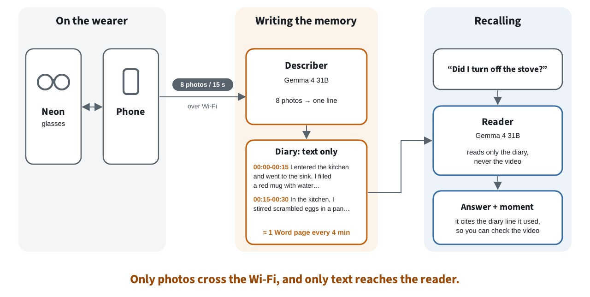

<p align="center"></p>

# Episodic memory assistant (prototype)

Camera glasses write a short text diary of your day, and you ask it about your recent past: "where did I leave my keys?", "did I turn off the stove?".



Every 15 seconds a vision-language model turns 8 photos into one diary line; a language model answers from the diary alone and cites the moment it used. It runs on recordings or live from [Pupil Labs Neon](https://pupil-labs.com/products/neon) glasses. The design and prompts follow Lando et al. ([2025](https://arxiv.org/abs/2506.16450), [2026](https://arxiv.org/abs/2602.22455)).

## What we found

Details in the blog: [part 1](https://enminxo.github.io/log/remembering-for-you/) (the glasses and the cost) and [part 2](https://enminxo.github.io/log/remembering-for-you-part-2/) (where it goes wrong).

- **It helps, but less than the score suggests.** On 500 four-option questions from QAEgo4D, the reader gets 53% right with the diary, 31% with no diary at all, and 59% with a diary written by people.
- **The mistakes come in three kinds.** A small describer copies objects from its own prompt, both describers write down things that did not happen ("no medication was taken"), and what happens between two photos never reaches the diary.
- **Keeping the diary is cheap; writing it is slow.** The diary grows by about one Word page every 4 minutes. The large describer needs about 10 s to write each 15 s of life.

The code of that evaluation is on the [`worktree-describer-eval`](https://github.com/Enminxo/ego-memory-assistant/tree/worktree-describer-eval/experiments/describer_eval) branch.

## Try it

A 66-second recording from the Neon glasses (walking to a window, pushing it shut, going through two doors) comes with the first release.

```bash
git clone https://github.com/Enminxo/ego-memory-assistant && cd ego-memory-assistant
uv sync
ollama pull gemma4:31b      # 19 GB, describer and reader
uv run egomem-app           # http://localhost:8090
curl -LO https://github.com/Enminxo/ego-memory-assistant/releases/download/v0.1.0/close-the-window.mp4
```

On the page, *+ Upload recording* takes `close-the-window.mp4` and writes the diary as the video plays. "What did I do at the window?" is answered, with its moment. "Did I close the window?" fails: the photos caught a hand on the glass, not the window closing, and the reader can only answer what the describer wrote down.


Any server with an OpenAI-compatible API works. We use [Ollama](https://ollama.com) with `gemma4:31b` for both roles; change `base_url` and `model` in `configs/demo.yaml` for llama-server or vLLM.

<details>
<summary>Why the describer is the slow part</summary>

Most of its time goes into reading the images, so it grows with their size. With gemma4:31b and the GPU to itself, 8 frames take about 11 s at 960×540, 18 s at 1280×960 and 26 s at 1600×1200 (the Neon scene camera's size). Smaller models are much faster (gemma4:e4b, about 5 s at full size), but in our tests they described objects that were not there.
</details>

## With Neon glasses

```bash
uv sync --extra neon
```

**Record, then ask.** Record with the Neon Companion app and copy the recording folder from the phone, or upload it from the page (*+ Upload recording* also takes Pupil Cloud's "Native Recording Data" zip, or any video).

```bash
uv run egomem-neon import ~/data/neon/<recording> --id kitchen --title "My kitchen"
# add questions to scenarios/kitchen.json, ideally before reading the diary
uv run egomem-build kitchen
uv run egomem-app
```

**Live, through the phone (recommended).** A relay on the glasses' phone sends only the diary's photos, 720 px wide, so a weak Wi-Fi delays them instead of losing them.

1. Install [Termux](https://f-droid.org/packages/com.termux/) on the phone, and [Tailscale](https://tailscale.com) on the phone and the computer.
2. In Termux, `pkg install python ffmpeg`, then:
   ```bash
   curl -LO https://raw.githubusercontent.com/Enminxo/ego-memory-assistant/master/src/egomem/phone_relay.py
   python phone_relay.py --bind <phone-tailscale-ip>
   ```
3. With the glasses plugged in and the Companion app open, press *● Go live* in `egomem-app`, type the phone's Tailscale address and choose *the phone relay*.

At 720 px the describer takes about 7-8 s per 15 s window (4 windows measured on a free GPU), so it keeps up; at the full 1,600 px it needed 29 s and dropped 20 of 46. Page sessions also record on the phone (`live.record` in `configs/demo.yaml`), and with Cloud upload on in Companion the recording goes to Pupil Cloud too.

<details>
<summary>How the relay works, and what it measured</summary>

The whole scene video is about 5 Mbit/s, and on our office Wi-Fi it did not fit: one afternoon 13 of 22 live clips were lost. Inside the phone nothing is in the way, so the relay reads the video at 127.0.0.1, picks the 8 photos of each clip and sends only those, about 0.7 Mbit/s. If the network drops, the photos wait on the phone and catch up later, each with the time it was taken.

```
glasses ─USB─▶ Companion app ─RTSP 127.0.0.1─▶ phone_relay.py ─photos─▶ egomem-app
               (on the phone)                  (Termux, same phone)     (your computer)
```

In a 10-minute test on 27 October 2026, all 403 photos arrived, none lost, about half a second late. A window the describer cannot reach in time is dropped and counted, never described late as if it were the present. The page shows the photos arriving, how late they are and how many wait on the phone.

The relay also serves the newest photo at `GET /latest.jpg` (3 per second) and speaks text through the phone with `POST /say` (needs `pkg install termux-api` and the Termux:API app).
</details>

<details>
<summary>Live without the relay: the whole video over the network</summary>

*● Go live* can also read the whole video straight from the Companion app, which needs a good network. From the terminal:

```bash
uv run egomem-live --neon <phone-ip> --probe   # phone, frames per second and lag; saves logs/neon_probe.jpg
uv run egomem-live --neon <phone-ip>           # a diary entry every 15 s, until Ctrl+C
uv run egomem-app                              # another terminal: the session is the tab marked ●
```

The phone and the computer must reach each other: on the same local network (the phone's IP is in the Companion app's streaming screen; eduroam usually does not work), or with Tailscale on both. Searching the network (no `--neon`) does not work through Tailscale.

The video is read over the Companion app's WebSocket (port 8686), the path its Monitor web page uses. Its plain RTSP stream (port 8086) sends UDP, and on our office Wi-Fi no keyframe ever arrived whole. Over the WebSocket nothing is lost, but on a congested network the frames queue up: 0.07 to 0.4 s late and 25-30 frames per second on a good network, 15 to 30 s and 5-10 frames per second on office Wi-Fi (26 October 2026). Past about 20 s the connection's keepalive times out and it reconnects.

`egomem-live --record` also records on the phone, keeping gaze and audio for later. It is off by default in the terminal because a recording may upload to Pupil Cloud.
</details>

## Evaluate on Ego4D

```bash
./scripts/make_demo_scenes.sh                       # four 8-minute scenes: stove, keys, medication, wallet
uv run egomem-build gas keys meds wallet            # video -> diary (data/memories/<scene>/default/)
uv run egomem-eval gas keys meds wallet             # accuracy on four-option questions
uv run egomem-eval gas keys meds wallet --no-memory # the same reader without a diary
uv run pytest
```

Always compare against `--no-memory`. QAEgo4D's wrong options were generated automatically and are often absurd ("on the ceiling"), so a reader scores well above the 25% chance level without seeing anything.

<details>
<summary>Datasets, the reader's answers, and your own scenes</summary>

[Ego4D](https://ego4d-data.org) and [QAEgo4D](https://github.com/lbaermann/qaego4d) **require signing their licenses**, so the scenes are not in the repository: `make_demo_scenes.sh` builds them from your own copies (`scripts/demo_scenes.yaml`).

In the evaluation the reader must always pick a letter (decoding constrained to A-D). Left free, with the diary in front of it, it declines to choose when the diary does not mention what is asked, and each refusal would count as a miss only for the arm that has a diary.

A scene is a JSON file in `scenarios/` with the video and its questions (format in `src/egomem/scenarios.py`). For your own recording, write it by hand, ideally before reading the diary:

```json
{
  "id": "pill", "title": "Did I take my pill?", "category": "medication",
  "video": "data/scenes/pill.mp4",
  "questions": [{"id": "p1", "question": "Did I take my pill?", "answer": "yes",
                 "wrong_answers": ["no", "I took two", "I only opened the box"],
                 "t0": 95.0, "t1": 102.0, "category": "medication"}],
  "demo_questions": [{"text": "Did I take my pill?", "expected": "yes"}]
}
```
</details>

## Pieces you can reuse

- **`src/egomem/neon_stream.py`**: Neon's scene camera live over WebSocket instead of UDP RTSP, with only `websockets` and PyAV.
- **`src/egomem/phone_relay.py`**: your own processing on the Companion phone, queued through network drops; one file, standard library plus ffmpeg.
- **The describer, the reader and the `--no-memory` control**: a small text-memory baseline for any video and any OpenAI-compatible model.

## Possible applications

- **Everyday recall.** Finding misplaced objects, or checking whether the door was closed or the stove switched off.
- **Routines and procedures.** Confirming which steps of a task were done, at home or at work.
- **Personal logging.** A searchable text record of a day that does not need the video to be kept.

<details>
<summary>Layout</summary>

| File | What it does |
|---|---|
| `src/egomem/sources.py` | Reads frames from a video at given times |
| `src/egomem/clips.py` | Cuts the video into clips and picks which frames the describer sees |
| `src/egomem/describer.py` | Clip → diary entry (the hook for other models) |
| `src/egomem/prompts.py` | Prompts of the describer and the reader |
| `src/egomem/memory.py` | The diary and the evidence frames |
| `src/egomem/reader.py` | Diary + question → answer with citations |
| `src/egomem/scenarios.py` | Scene format and building scenes from Ego4D |
| `src/egomem/neon.py` | Neon glasses: recording → scene, and the live scene camera with its phone |
| `src/egomem/neon_stream.py` | The scene camera's video over the Companion app's WebSocket (RTSP, RTP, H.264) |
| `src/egomem/phone_relay.py` | Runs on the phone: picks the diary's photos and sends them, queued through drops |
| `src/egomem/phone.py` | This side of the relay: assembles the photos into clips |
| `src/egomem/live.py` | Live session: wall-clock sampling, the diary written as it arrives, and *Go live* |
| `src/egomem/uploads.py` | Recordings uploaded from the app: converted to a scene, then described |
| `src/egomem/build_memory.py`, `evaluate.py`, `app.py` | The three commands |
</details>

## License

MIT, see `LICENSE`. Ego4D and QAEgo4D have their own licenses, which the demo scenes require.
